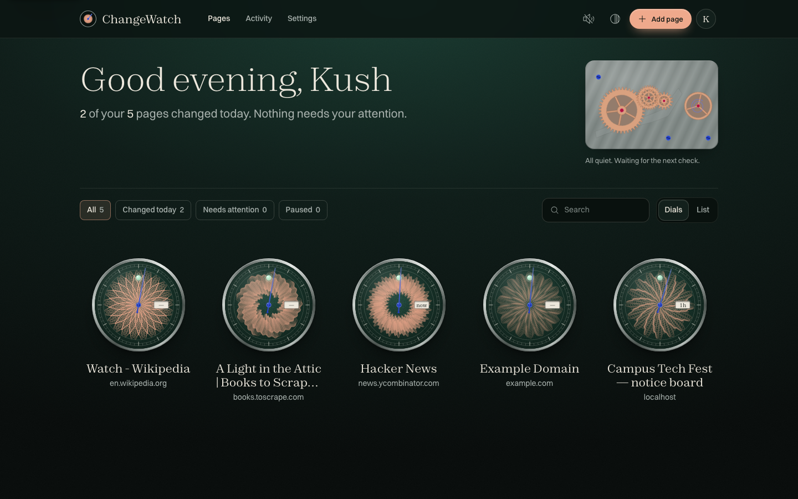
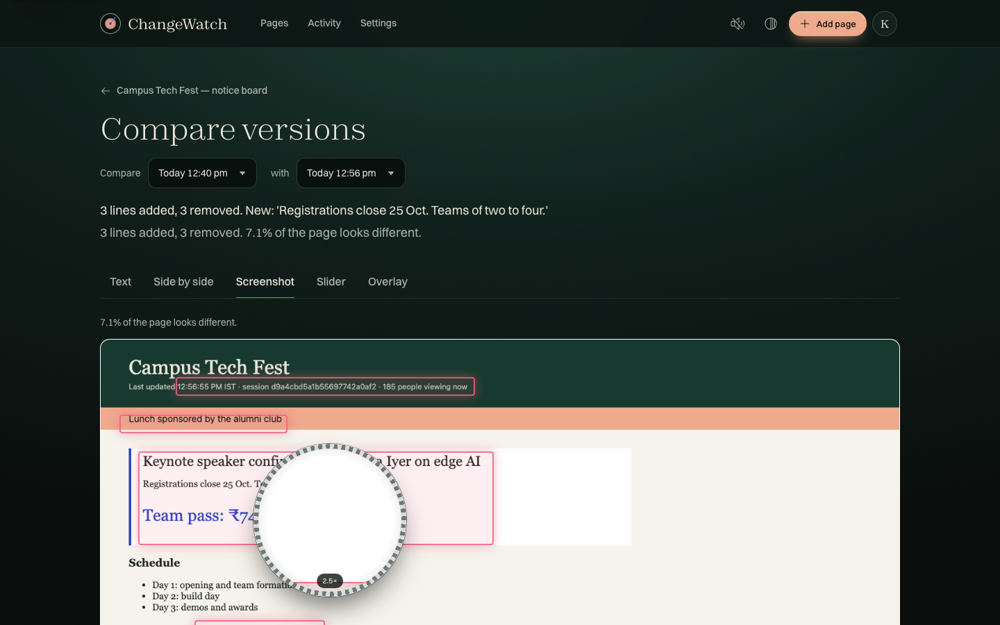
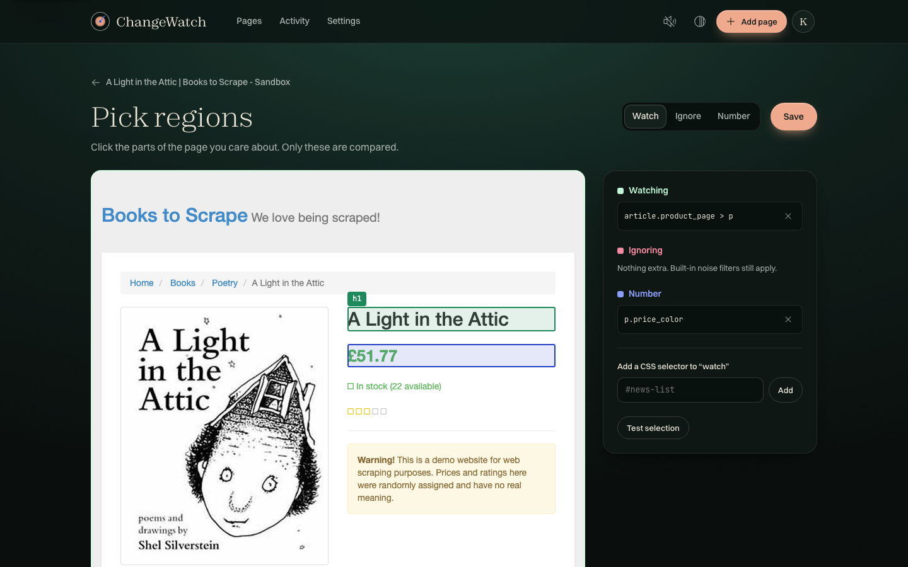
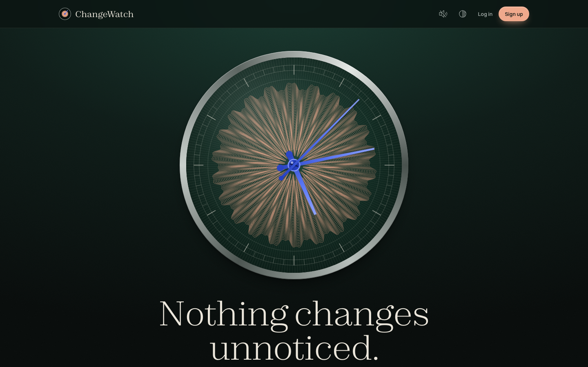
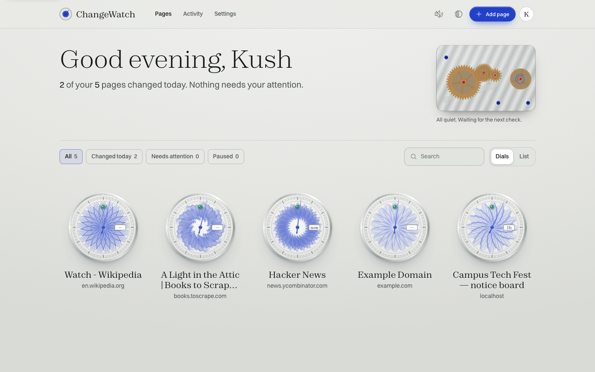
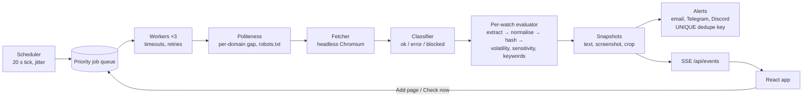

# ChangeWatch

**Watch any public web page. Ignore the noise. Hear about the changes that matter.**

ChangeWatch renders pages in a real headless browser on a schedule, strips out timestamps, counters,
ads, rotating banners and random tokens, learns which parts of a page change on every load, and alerts
you by email, Telegram or Discord, once per real change, with a one-line summary and a link to a
word-level and screenshot comparison. Every page you watch becomes its own watch dial, engraved with
a guilloché pattern generated from its address.

Built for VinnovateIT Round 1 by Kushagra Singhal.



| Compare with the loupe | Pick regions |
|---|---|
|  |  |
| **Landing** | **Opaline theme** |
|  |  |

## Live demo

- **URL:** *(added after deployment; see Deployment below)*
- **Demo login:** `demo@changewatch.app` / `watch-the-dials` (created by `python -m app.seed`)
- **Try:** `/demo/changing-page` (noisy on every load, really changes every 5 minutes),
  `/demo/bot-check` (a fake CAPTCHA wall), `/demo/outage` (always 503), `/bot` (about our crawler),
  `/healthz`.

## Core requirements, and where they live

| # | Requirement | How | Files |
|---|---|---|---|
| 1 | Add URL, name, interval (15 min–24 h); headless rendering | Server-side interval validation; URL normalisation; SSRF guard; Playwright Chromium (fresh context per check, ads/fonts/media blocked, animations frozen, full-page screenshot) | `routes/watches.py`, `urlnorm.py`, `security.py`, `fetcher.py` |
| 2 | Scheduler + job queue, timeouts, retries; public pages only, no credentials | 20 s scheduler tick with ±10% jitter; priority queue with 3 workers; 3 attempts (5/20/60 s backoff); 45 s render cap; failure backoff; `user:pass@` rejected, no cookies stored | `scheduler.py`, `jobqueue.py`, `checker.py` |
| 3 | Text + screenshot per check; new snapshot only when the hash changes | Extract → normalise → SHA-256; snapshot with crop + thumbnail only on a significant change; files kept only when used | `extract.py`, `noise.py`, `checker.py`, `visual_diff.py` |
| 4 | Noise filtering + sensitivity | Regex normalisation (live dates, times, counters, tokens), structural removal (cookies, ads, chat, carousels), learned volatility rules, Low/Medium/High thresholds, flapping guard | `noise.py`, `extract.py`, `checker.py` |
| 5 | Visual picker for watch/ignore regions (CSS selectors) | Stored snapshot, sanitised, in a sandboxed iframe with a CSP nonce; stable-selector algorithm; Watch / Ignore / Number modes; test + save + re-baseline | `picker/*`, `routes/picker.py`, `pages/Picker.tsx` |
| 6 | Text diff, highlighted screenshot diff, side by side, any two versions | Line + word diff; shift-aware pixel diff with regions; unified, side-by-side, screenshot + loupe, slider and overlay views | `differ.py`, `visual_diff.py`, `pages/Compare.tsx`, `components/diff/*` |
| 7 | Email + Telegram/Discord alerts, summary + diff link, no duplicates, daily digest | UNIQUE `dedupe_key` claimed before sending; per-channel retries; SMTP or Resend; status alerts; digest at your local hour | `alerts.py`, `digest.py`, `routes/settings.py` |
| 8 | Per-page timeline; dashboard with last checked, last changed, status | Dials (or a sortable table) with live SSE updates; History timeline with any-two compare; Activity feed | `pages/Dashboard.tsx`, `components/timeline/*`, `routes/stats.py`, `realtime/useEvents.ts` |

## The four design questions, answered

1. **Is a site outage or CAPTCHA a change? No.** Every fetch is classified before any diffing
   (`fetcher._classify_status`, `fetcher._looks_like_bot_wall`, plus a text-collapse check in
   `checker.compare_with_baseline`). Errors (timeouts, DNS, 5xx, 404) and blocks (401/403/429, bot
   walls) never create snapshots. The last good version stays the baseline, so recovery doesn't look
   like "everything changed". After 3 consecutive failures each watcher gets one clearly labelled status
   alert, and one "back to normal" on recovery (`alerts.on_status`). We never try to solve CAPTCHAs.
2. **Is a URL watched by 200 users fetched 200 times? No, once.** One *Target* per normalised URL
   (`urlnorm.normalise_url`, UNIQUE `targets.url`); every *Watch* is evaluated from the same render
   (`checker.handle_success`); in-flight dedupe in the queue; and a conditional request
   (`If-None-Match`/`If-Modified-Since`) skips the browser on `304` for static pages
   (`checker.conditional_unchanged`). The UI says "N other people watch this page too — fetched once
   for everyone"; `/system` shows the sharing ratio.
3. **How do you avoid endless alerts on pages that differ on every load?** Normalisation regexes,
   structural removal, user ignore regions, watching only a picked region, a confirmation re-fetch
   ~10 s later with learned volatility rules (only changes present in both loads count), sensitivity
   thresholds, keyword-only mode, a flapping guard, and content-hash alert dedupe (`noise.py`,
   `checker.learn_rules`, `checker.common_change`, `checker.after_change`).
4. **How do you avoid hammering a site?** `politeness.py`: one concurrent request per registrable
   domain, at least 10 s apart (or the site's Crawl-delay), robots.txt cached 24 h, `Retry-After`
   honoured, exponential failure backoff, jitter, a 15-minute minimum interval, a 2-minute manual
   cooldown, shared fetching, 304 skips, blocked heavy assets, a global page cap, and an honest user
   agent with a `/bot` page.

## Architecture



**How the frontend and backend work together.** The React app never touches the database; it calls
the JSON API under `/api` and listens to Server-Sent Events at `/api/events`. In development, Vite
(port 5173) proxies `/api`, `/rss`, `/demo`, `/healthz` and `/bot` to FastAPI (port 8000), so the
browser sees one origin. In production one Docker container serves both: FastAPI serves the built
frontend with an SPA fallback. API types are generated from the backend's OpenAPI
(`npm run gen:api`), so the two can't drift apart. Split hosting is supported through `CORS_ORIGINS`
and `VITE_API_BASE`.

## The noise pipeline, step by step

1. **Classify** the fetch: errors and blocks stop here.
2. **Remove** scripts, hidden elements, cookie/consent banners, ads, chat widgets, carousels (optional
   per page), your ignore regions and learned volatile elements.
3. **Keep** only your picked regions, or the whole body.
4. **Normalise** each line: times, dates within 2 days of the check, relative times, countdowns,
   engagement counters, random tokens and copyright years become placeholders. Prices and plain numbers
   stay.
5. **Compare** with the baseline (re-normalised with today's rules).
6. **Threshold** by sensitivity (High: any; Medium: ≥20 chars or a new line and ≥0.1%; Low: ≥100 chars
   and ≥2%).
7. **Confirm** with a second load ~10 s later and learn whatever differs between the two loads.
8. **Guard** against flapping (≥4 changes in 6 h or A→B→A→B raises the threshold for 24 h).
9. **Dedupe** alerts by content hash and channel.

## Bonus features

- **Keyword-only alerts:** appears / disappears / mentioned in a changed line; the triggering word is
  recorded.
- **Number tracking with charts:** CSS selector (pickable) and/or regex; Indian, US and European
  formats, K/M, %, negatives; chart with change markers; thresholds alert once per crossing.
- **AI one-line summaries:** Anthropic Messages API (`claude-haiku-5-5` by default) when
  `ANTHROPIC_API_KEY` is set, with a heuristic summary otherwise or on any failure.
- **Per-page RSS feed:** `/rss/{token}.xml`, latest 30 versions, regenerable token.
- **Extras:** shared setups (`/import/{token}`), the "fetched once for everyone" message, the `/system`
  admin view, a live Movement (gear train driven by the queue), sounds, two themes.

## Design: haute horlogerie for the web

Two themes (Fumé and Opaline), Zodiak + Switzer + JetBrains Mono, and textures in pure CSS/SVG. Each
dial is generated from the page's URL hash: style, petal count, line count and amplitudes are drawn
from a seeded PRNG, and each line is `r(θ) = base + A·sin(kθ+φ) + A2·sin(kmθ−φ/2)`. The blued sweep
hand is one CSS animation per dial, the jewel is the status, the date window is time since the last
change. See `docs/04-design-system.md` and `docs/03-frontend-tour.md`.

## Local setup (macOS)

```bash
# Backend
cd backend
python3 -m venv .venv && source .venv/bin/activate
pip install -r requirements.txt && playwright install chromium
cp .env.example .env
uvicorn app.main:app --reload --port 8000

# Frontend (second terminal)
cd frontend && npm install && npm run dev      # http://localhost:5173

# Or both at once from the repo root
./dev.sh

# Tests and demo data
cd backend && .venv/bin/pytest -q              # 129 tests
.venv/bin/python -m app.seed                   # demo@changewatch.app / watch-the-dials
```

Only `BASE_URL` and `SECRET_KEY` matter; email (SMTP or Resend), Telegram, Discord and AI are optional
and show "Not set up" when missing. For local scheduling tests, `DEBUG_FAST_SCHEDULE=true` treats minutes
as seconds.

## Deployment (one container)

**Render (recommended here):** push this repo to GitHub → render.com → **New → Blueprint** → choose the
repo. `render.yaml` defines a Docker web service (one instance), a 1 GB disk at `/data`, the `/healthz`
health check, and env vars (`SECRET_KEY` is generated). Set `BASE_URL` to the service's
`https://….onrender.com` address (it must match exactly, or sign-up is refused by the CSRF Origin check).
Then open `/healthz`. Optionally run `python -m app.seed` from the Render Shell. Use the Starter plan:
free instances can't keep a disk and they sleep, which also stops the scheduler.

**Railway:** new project from the GitHub repo → add a Volume at `/data` → set `BASE_URL` and
`SECRET_KEY` → deploy (`railway.json` sets the Dockerfile builder and health check).

**Why one Uvicorn worker:** the scheduler, job queue and SSE bus live in the process. A second worker
would run a second scheduler and miss events.

## Limitations and future work

- Single process: for horizontal scaling, move the queue and event bus to Redis, the database to
  Postgres and screenshots to S3 (the `JobQueue` and `EventBus` classes are the seams).
- The visual diff compares whole pages; it doesn't yet ignore regions removed as noise.
- No browser extension (skipped as the brief allowed), and no per-user API keys yet.
- At-most-once alert delivery: a crash between recording and sending can lose one alert, but never
  duplicate one.

## Documentation

- `docs/01-big-picture.md`: the system on one page, and what happens when you click Add page
- `docs/02-backend-tour.md` and `docs/03-frontend-tour.md`: every file, and how the animations work
- `docs/04-design-system.md`: palette, type, motion and why
- `docs/05-concepts.md`: the concepts behind it, explained simply
- `docs/06-questions-and-answers.md`: 70 likely questions with answers
- `docs/07-demo-script.md`: a four-minute demo
- `docs/BUILD-LOG.md`: what was built in each phase, and every decision
