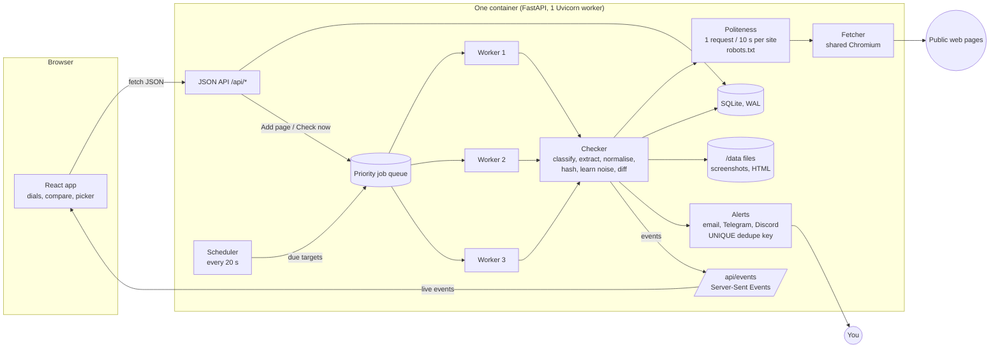

# The big picture

ChangeWatch watches public web pages and tells you when something *meaningful* changes. It has two
apps. A **Python backend** (FastAPI) holds the database and runs the engine: a scheduler, a job queue,
a headless Chrome and the noise filters. A **React frontend** (Vite + TypeScript) shows every watched
page as its own engraved watch dial. In production both run in one Docker container: FastAPI serves
the built frontend and the JSON API from the same address.

## The one idea to remember: Targets vs Watches

- A **Target** is one web address, normalised so that `Example.com/?utm_source=x` and
  `https://example.com/` are the same thing. Each Target is fetched once per cycle.
- A **Watch** is one user's subscription to a Target. It holds that user's name, interval, regions,
  ignore rules, sensitivity, keywords, number tracking and alert channels.
- One fetch → one rendered page and one screenshot → **every Watch on that Target is evaluated from
  it**. If 200 people watch the same page, it is still fetched once.

## What happens when you click "Add page"

The trace follows a request through every layer. File and function names are real, so you can open
them alongside.

1. **Frontend form.** `pages/AddPage.tsx` sends `POST /api/watches` with `{url, name, interval_minutes,
   sensitivity, ...}` through `api/client.ts → api()`. That helper adds the session cookie
   (`credentials: 'include'`) and turns errors into `ApiError`.
2. **Security middleware.** `security.py → OriginCheckMiddleware` checks the `Origin` header is our own
   site (CSRF protection). `auth.py → current_user()` verifies the signed `cw_session` cookie.
3. **Validation.** `routes/watches.py → create_watch_for()`:
   - `check_interval()` rejects anything outside 15–1440 minutes (the server never trusts the form).
   - `urlnorm.normalise_url()` lowercases the address and drops tracking parameters and fragments.
   - `security.check_url_is_public()` resolves DNS and refuses private, loopback and metadata IPs (SSRF).
4. **Database.** `find_or_create_target()` runs `INSERT OR IGNORE` on `targets` (the URL is UNIQUE),
   then the watch row is inserted with a random RSS token.
5. **Queue.** `jobqueue.queue.enqueue(target_id, priority=0)`. Priority 0 means a person is waiting,
   so it goes ahead of scheduled checks. If the target is already queued or running, it attaches
   instead of creating a duplicate job.
6. **Worker.** One of the 3 workers (`JobQueue._worker`) picks the job and calls
   `checker.check_target()`. Up to 3 attempts, with backoff of 5, 20 and 60 s, apply to retryable
   failures.
7. **Politeness.** `politeness.robots_allows()` checks robots.txt (cached 24 h).
   `politeness.slot(url)` waits until the site's 10-second gap has passed and holds the site so only
   one request runs at a time.
8. **Playwright.** `fetcher.render()` opens a fresh browser context (no cookies), blocks ads, fonts and
   media plus every private-network sub-request, waits for the page to settle, freezes animations,
   and takes a full-page screenshot (up to 8000 px tall). It also collects HTML, title and element
   boxes.
9. **Classification (design question 1).** `_classify_status()` and `_looks_like_bot_wall()` decide
   between *ok*, *error* (timeouts, 5xx, 404) and *blocked* (401/403/429, CAPTCHAs). Errors and
   blocks stop here: no snapshot, and after 3 failures one status alert.
10. **Extraction.** `extract.extract()` removes scripts, hidden elements, cookie banners, ads, chat
    widgets, carousels and your ignore regions. It keeps only your picked regions (or the whole body)
    and turns the HTML into clean lines of text.
11. **Noise.** `noise.normalise_text()` rewrites live times, dates near today, relative times,
    countdowns, view counters and random tokens into placeholders (`<TIME>`, `<COUNT>`...). Raw and
    normalised lines stay aligned 1:1.
12. **Hash and compare.** `checker.compare_with_baseline()`. With no previous version the result is
    "first"; a page whose text collapsed is "blocked"; identical normalised text is "unchanged"; a
    difference below the sensitivity threshold is "ignored_minor"; anything else is "suspected".
13. **Confirmation (design question 3).** A suspected change triggers a second render ~10 s later.
    Lines that differ between the two loads become learned rules (`learn_rules()`). Only changes
    present in both loads count.
14. **Snapshot.** `create_snapshot()` stores the text, its SHA-256 hash, the diff stats and a
    one-line summary. The screenshot and gzipped HTML go under `/data/fetches/...`, plus a crop of
    your region and a 480 px thumbnail.
15. **Alerts.** `alerts.on_change()` inserts one `alerts` row per enabled channel with a UNIQUE
    `dedupe_key`. Only if that insert succeeds does it send, in the background, with 3 retries. In
    daily-digest mode the row waits for `digest.py`.
16. **Live update.** `events.bus.publish()` puts `check_started`, `check_finished` and `change`
    events on your open tabs' queues. `/api/events` streams them, and `realtime/useEvents.ts` updates
    the TanStack Query cache.
17. **The dial.** The dashboard re-renders: the lume arc stops, the sweep hand re-syncs to the next
    check, the date window rolls to "now", the engraving replays once, and a toast says "VIT News
    changed: ..." with a Compare button.

## Where things live

| Folder | What's in it |
|---|---|
| `backend/app/` | The engine and API (see `02-backend-tour.md`) |
| `backend/tests/` | 129 pytest tests: noise rules, sensitivity, diff, dedupe, URLs, SSRF, numbers, classification |
| `frontend/src/` | The React app (see `03-frontend-tour.md`) |
| `docs/` | These explanations, the Q&A and the demo script |
| `Dockerfile`, `render.yaml`, `railway.json` | Production: one container, one disk at `/data` |
